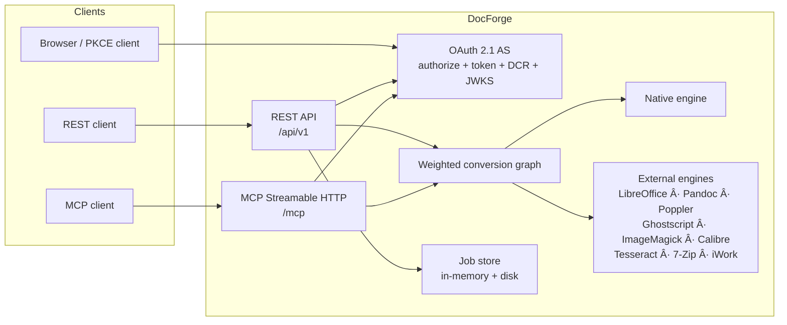

# DocForge

**One conversion graph. Two first-class interfaces. OAuth everywhere.**

DocForge is a Rust service that converts documents between **PDF, Office, Markdown, HTML, spreadsheets, images, e-books, and structured data**, and exposes the same engine through:

- a **REST API** (`/api/v1`) protected by **OAuth 2.1 authorization code + PKCE (S256)**;
- an **MCP server** (`/mcp`) using the **Streamable HTTP** transport, **OAuth 2.1 + PKCE**, **dynamic client registration**, and **RFC 9728 protected-resource discovery**;
- a local **stdio MCP** mode for desktop clients;
- **Keycloak** as the local OAuth 2.1 / OIDC identity provider (default in Docker Compose), with realm import, audience mappers, PKCE clients, and anonymous DCR configured;
- an **embedded OAuth 2.1 authorization server** (Ed25519 JWTs, JWKS, refresh-token rotation, DCR) for zero-dependency local runs and tests.

The product catalog is exactly the 100 conversions in [`catalog/conversions.json`](catalog/conversions.json). The planner treats those rows as a weighted graph, so it can also build **multi-hop routes** (for example `PPTX -> PDF -> JPG`) according to which engines are installed.

The native engine also supports **Outlook `.msg` → Markdown** (plus TXT/HTML/DOCX/PDF), using the MAPI body, sender/recipients/date, and attachment names. This is an extended route outside the 100 ranked rows; `/api/v1/formats` and `/mcp` list it, and `POST /api/v1/conversions/plan` resolves it.

---

## Quick start

### Docker with Keycloak (recommended)

```bash
docker compose up --build
```

This starts:

| Service | URL | Credentials |
| --- | --- | --- |
| DocForge REST/MCP | <http://localhost:8080> | Keycloak user `demo` / `demo` |
| Keycloak | <http://localhost:8081> (admin console) | `admin` / `admin` |
| Keycloak realm | `docforge` | imported from `deploy/keycloak/realm.json` |
| API docs | <http://localhost:8080/docs> | — |

Keycloak is the local OAuth 2.1 / OIDC IdP. The realm import creates:

- public PKCE clients `docforge-rest` and `docforge-mcp`;
- confidential automation client `docforge-api` (secret `docforge-api-secret`, dev only);
- scopes `convert`, `convert:read`, and `mcp` with audience mappers for `http://localhost:8080/api` and `/mcp`;
- a demo user (`demo` / `demo`);
- anonymous DCR with trusted hosts `localhost`, `127.0.0.1`, and `host.docker.internal`.

Keycloak's admin console is exposed on `8081` for local development only. **Change the admin password and demo user before exposing anything.**

### Docker with the embedded OAuth server (no Keycloak)

```bash
docker compose -f docker-compose.embedded.yml up --build
```

The embedded server supports DCR, PKCE, and Ed25519 JWTs, with the demo login configured by `AUTH_PASSWORD`.

### Local Rust

```bash
cp .env.example .env          # edits: AUTH_MODE, PUBLIC_BASE_URL, ...
cargo run -p docforge-server -- serve
```

With `AUTH_MODE=embedded` (the `.env.example` default) no external identity provider is needed. To run against a local Keycloak, set `AUTH_MODE=keycloak` and the `KEYCLOAK_*` URLs from `.env.example`, or use Compose.

### Terminal CLI

The same `docforge` binary is also a local conversion CLI. It does **not** require OAuth, Keycloak, or a running server:

```bash
docforge convert report.pdf --to docx -o report.docx
docforge convert notes.md pdf
docforge convert scan.jpg --to txt --ocr --ocr-language eng
docforge convert mail.msg --to md -o mail.md

# stdin/stdout pipelines
cat notes.md | docforge convert - --to pdf --stdout > notes.pdf

# batch a directory
docforge batch ./inbox --to pdf --output-dir ./out --recursive

# inspect before converting
docforge plan msg md
docforge formats --available-only
docforge engines
```

Use `docforge convert --help` for PDF DPI/page options, OCR language, CSV delimiters, timeouts, and `--json`/`--force`/`--quiet`. `docforge batch` skips existing outputs unless `--force`; use `--continue-on-error` for large batches.

On Windows PowerShell, `>` writes text, not raw bytes, so binary PDF output must use `--output`:

```powershell
.\\docforge.exe convert .\\input.docx --to pdf --output .\\output.pdf
```

or a `cmd.exe` redirect:

```bat
cmd /c "docforge.exe convert input.docx --to pdf --stdout > output.pdf"
```

Set `DOCFORGE_TMP` if the system temporary directory is not writable. Build/install the binary with:

```bash
cargo build --release -p docforge-server
# binary: target/release/docforge
# or: cargo install --path crates/server
```

See [CLI details](docs/CLI.md).

Requirements: stable Rust 1.100+ (the workspace is tested with current stable) and, for the full catalog, optional external tools (see the engine matrix below). Native-only mode works without any external binary for the core text/data/image conversions, including Office-to-PDF and PDF rasterization.

```bash
# See which engines were detected and which catalog rows are currently routable.
docforge formats

# Local conversion using the same planner as the API.
docforge convert input.docx pdf
```

The server prints its REST, MCP, OAuth discovery, and docs URLs at startup.

---

## Architecture



| Crate | Responsibility |
| --- | --- |
| `crates/core` | Formats, 100-row catalog, weighted planner, document model, native adapters, external engine adapters, job-free conversion service |
| `crates/auth` | OAuth 2.1 server, PKCE, DCR, Ed25519 JWTs/JWKS, RFC 8414 + RFC 9728 metadata, REST/MCP middleware |
| `crates/mcp` | JSON-RPC 2.0, MCP Streamable HTTP, stdio transport, tools/resources/prompts |
| `crates/server` | REST routes, async jobs, uploads/downloads, OpenAPI, binary and configuration |

More detail: [Architecture](docs/ARCHITECTURE.md), [OAuth](docs/OAUTH.md), [MCP](docs/MCP.md), [Conversions](docs/CONVERSIONS.md).

---

## Authentication

DocForge has two modes, selected by `AUTH_MODE`:

| Mode | Authorization server | Token model | Default use |
| --- | --- | --- | --- |
| `keycloak` | Keycloak realm `docforge` | Keycloak RS256 JWT, validated via realm JWKS | Docker Compose |
| `embedded` | DocForge `/oauth/*` | DocForge Ed25519 JWT | local `cargo run`, tests |

The REST API and MCP **resource** side is identical: both validate the Bearer JWT's signature, issuer, audience, expiry, and scopes.

### Keycloak: REST API

All `/api/v1` routes require a Bearer token with `convert` or `convert:read` and an audience of `PUBLIC_BASE_URL/api`.

1. Use the pre-registered public client `docforge-rest` (`http://localhost:9876/callback` is registered), or let a DCR-capable client register at `http://localhost:8081/realms/docforge/clients-registrations/openid-connect`.
2. Send the browser to `http://localhost:8081/realms/docforge/protocol/openid-connect/auth` with:
   `client_id=docforge-rest`, `response_type=code`, `scope=openid convert`,
   `redirect_uri=http://localhost:9876/callback`, `code_challenge=...`, `code_challenge_method=S256`.
3. Exchange the code at `http://localhost:8081/realms/docforge/protocol/openid-connect/token` with `code_verifier`.

Keycloak issues the token. DocForge fetches the realm JWKS and rejects tokens whose `aud` does not include `http://localhost:8080/api` or whose scope lacks `convert`/`convert:read`.

### Keycloak: MCP

MCP clients discover the protected resource from the `WWW-Authenticate` challenge or:

```
GET http://localhost:8080/.well-known/oauth-protected-resource/mcp
```

The document points at `http://localhost:8081/realms/docforge`. Keycloak discovery advertises:

```
registration_endpoint:  .../clients-registrations/openid-connect
authorization_endpoint: .../protocol/openid-connect/auth
token_endpoint:         .../protocol/openid-connect/token
jwks_uri:               .../protocol/openid-connect/certs
code_challenge_methods_supported: ["S256", "plain"]
```

MCP requires the `mcp` scope and an audience of `http://localhost:8080/mcp`. Pre-registered client `docforge-mcp` accepts `http://localhost:6274/oauth/callback` (MCP Inspector) and `http://localhost:9876/callback`. Anonymous DCR is configured with trusted hosts `localhost`, `127.0.0.1`, and `host.docker.internal`; dynamically registered clients inherit the realm's default scopes (`convert`, `convert:read`, `mcp`).

### Embedded: REST API + MCP

Without Keycloak, the built-in server exposes `/oauth/authorize`, `/oauth/token`, `/oauth/register`, and `/oauth/jwks`. Use the flow in [`examples/rest_pkce.ps1`](examples/rest_pkce.ps1) or [`examples/rest_curl.sh`](examples/rest_curl.sh) against `docker-compose.embedded.yml`. MCP clients use the same protected-resource metadata and DCR at `/oauth/register`.

### Scopes

| Scope | Used by | Meaning |
| --- | --- | --- |
| `convert` | REST | Create conversions/jobs and download results |
| `convert:read` | REST | Read formats, catalog, plans, and job status |
| `mcp` | MCP | Use `/mcp` tools/resources/prompts |
| `offline_access` | both | Request a refresh token |

### Discovery endpoints

| Endpoint | Purpose |
| --- | --- |
| `/.well-known/oauth-authorization-server` | RFC 8414 metadata; in Keycloak mode points to Keycloak |
| `/.well-known/openid-configuration` | Alias for the same metadata |
| `/.well-known/oauth-protected-resource` | MCP protected-resource metadata (root) |
| `/.well-known/oauth-protected-resource/mcp` | MCP protected-resource metadata |
| `/.well-known/oauth-protected-resource/api` | REST protected-resource metadata |
| `/oauth/jwks` | Embedded Ed25519 JWKS (Keycloak JWKS is served by Keycloak) |
| `/openapi.yaml`, `/openapi.json` | API discovery |
| `/docs` | Swagger UI |

---

## MCP

Endpoint: `POST /mcp` (Streamable HTTP). Session header: `Mcp-Session-Id`. Protocol versions: `2025-06-18`, `2025-03-26`, `2024-11-05`.

### Tools

| Tool | Purpose |
| --- | --- |
| `list_formats` | Canonical formats, MIME types, extensions, catalog targets |
| `list_conversions` | The 100 rows with category, use case, availability, route |
| `plan_conversion` | Shortest engine route, including multi-hop fallbacks |
| `convert_document` | Convert base64 or text content inline; returns a base64 MCP resource (≤16 MiB by default) |
| `server_info` | Version, limits, discovery URLs |

### Resources

`docforge://formats`, `docforge://conversions`, `docforge://engines`, `docforge://server`, `docforge://conversions/{rank}`, `docforge://formats/{id}`.

### Local stdio

```bash
docforge mcp --stdio
```

Stdio mode is trusted-local and does not apply OAuth; it uses the identical tool handlers.

### Example client configuration

For clients that support remote MCP with OAuth discovery:

```json
{
  "mcpServers": {
    "docforge": {
      "type": "http",
      "url": "http://127.0.0.1:8080/mcp"
    }
  }
}
```

The client should receive `401` with `WWW-Authenticate: Bearer resource_metadata="…/mcp"`, then run DCR + PKCE + the browser login. The demo credentials are `demo` / `demo` unless configured otherwise.

See [MCP details](docs/MCP.md).

---

## REST API

Base: `/api/v1` (all protected unless noted).

| Method | Path | Description |
| --- | --- | --- |
| `GET` | `/formats` | Formats and targets |
| `GET` | `/conversions` | 100 catalog rows with live availability/route |
| `GET` | `/conversions/{rank}` | One catalog row |
| `POST` | `/conversions/plan` | Plan a route |
| `GET` | `/engines` | Detected/missing engines |
| `GET` | `/stats` | Catalog and graph statistics |
| `POST` | `/convert` | Synchronous multipart conversion (≤25 MiB default) |
| `POST` | `/jobs` | Asynchronous multipart conversion |
| `GET` | `/jobs` | List your jobs |
| `GET` | `/jobs/{id}` | Job status |
| `GET` | `/jobs/{id}/download` | Download completed output |
| `DELETE` | `/jobs/{id}` | Cancel or delete |

Multipart fields: `file`, `target_format`, optional `source_format`, `options` (JSON), or `rank` to use a catalog row. The synchronous response is the file itself with `X-DocForge-Route` and `X-DocForge-Duration-Ms`.

Example after obtaining `$TOKEN`:

```bash
curl -X POST http://127.0.0.1:8080/api/v1/convert \
  -H "Authorization: Bearer $TOKEN" \
  -F "file=@document.pdf" \
  -F "target_format=docx" \
  -o document.docx
```

---

## Conversion engines

DocForge ships two pure-Rust engines and probes optional external tools at startup. The native engines are always available; missing external tools are shown by `/api/v1/engines` and excluded from routing.

### Native engines

| Engine | Coverage | Notes |
| --- | --- | --- |
| `native` | TXT/MD/HTML/DOCX/ODT/RTF/PDF/EPUB/PPTX; CSV/TSV/XLSX/ODS/JSON/XML/YAML/TOML; VCF/ICS; JPG/PNG/TIFF/WEBP/BMP/SVG; CBZ; EML; Outlook MSG | Structural document engine plus native data/image adapters |
| `native` | DOCX/PPTX/XLSX → PDF | `office2pdf`/Typst renderer; cost 6, falls back to the structural renderer if a file is unsupported |
| `native` | PDF → PNG/JPG/TIFF | `pdf-render`; selected page or first page, DPI from `options.pdf.dpi`; transparency flattened onto white |
| `native-ocr` | Images → TXT/PDF; PDF → TXT (OCR) | Embedded `ocrs` models for English/Latin; no external binary or model download |

Native Office-to-PDF is preferred on a cost tie with LibreOffice, so a normal installation uses the pure-Rust path first. PDF rasterization is also native-first; Poppler/Ghostscript remain available for PDF features the native renderer does not cover. Native OCR is a fallback: when Tesseract is installed its lower advertised cost keeps it preferred for higher accuracy, additional languages, and searchable PDF.

### Optional external engines

| Engine | Tool | Unlocks / role |
| --- | --- | --- |
| LibreOffice | `soffice` | Legacy DOC/PPT/XLS, exact/high-fidelity Office/ODF layout, fallback for complex files |
| Pandoc | `pandoc` | Broad Markdown/HTML/DOCX/ODT/EPUB/LaTeX/RTF/PPTX structural conversions |
| Poppler | `pdftotext`, `pdftoppm`, `pdftohtml`, `pdftocairo` | PDF → SVG/vector output, text/HTML, and raster fallback |
| Ghostscript | `gs` | PS ↔ PDF, XPS, and PDF raster fallback |
| ImageMagick | `magick` | HEIC, image operations, and fallback rasterization |
| Calibre | `ebook-convert` | EPUB ↔ MOBI, EPUB → PDF/DOCX |
| Tesseract | `tesseract` + Poppler | Higher-accuracy/multi-language OCR, searchable PDF |
| 7-Zip | `7z` | CBR extraction |
| DjVuLibre | `ddjvu`, `cjb2`, `djvm` | DjVu ↔ PDF |
| gxps | `gxps` | XPS → PDF |
| antiword | `antiword` | Legacy DOC → TXT |
| FFmpeg | `ffmpeg` | HEIC → JPG/PNG |
| Apple iWork | `osascript` | Pages/Key/Numbers (macOS only) |

The full [Dockerfile](Dockerfile) installs the Linux-capable external set. Pages/Key/Numbers are only available on macOS because they rely on AppleScript export.

**Fidelity notes.** The structural native document route preserves block structure (headings, paragraphs, lists, tables, code), not typography. DOCX/PPTX/XLSX→PDF uses `office2pdf`/Typst and is substantially richer, but is not a pixel-perfect LibreOffice clone; LibreOffice remains available for exact/complex layout. PDF rasterization uses `pdf-render` and returns the selected/first page unless an engine supports multi-page output. PDF text extraction uses the PDF text layer; scanned PDFs use native `ocrs` (English/Latin) when Tesseract is not installed (`options.ocr=true`). PDF table extraction is heuristic.

See [Conversions](docs/CONVERSIONS.md) for the full routing policy and per-category notes, and [Third-party notices](THIRD_PARTY.md) for bundled engine/model licenses.

---

## Configuration

Environment variables (see [`.env.example`](.env.example)):

| Variable | Default | Notes |
| --- | --- | --- |
| `BIND_ADDR` | `127.0.0.1:8080` | Use `0.0.0.0:8080` in Docker |
| `PUBLIC_BASE_URL` | `http://127.0.0.1:8080` | Used in discovery and download links |
| `AUTH_MODE` | `embedded` | `keycloak` to use an external Keycloak realm |
| `AUTH_ISSUER` | `PUBLIC_BASE_URL` | Authorization-server issuer; in Keycloak mode use the realm URL |
| `AUTH_REST_RESOURCE` | `${PUBLIC_BASE_URL}/api` | JWT audience for REST |
| `AUTH_MCP_RESOURCE` | `${PUBLIC_BASE_URL}/mcp` | JWT audience for MCP |
| `KEYCLOAK_ISSUER` | `http://localhost:8081/realms/docforge` | Keycloak realm issuer (`iss`) |
| `KEYCLOAK_JWKS_URL` | `${KEYCLOAK_ISSUER}/protocol/openid-connect/certs` | Internal JWKS URL |
| `KEYCLOAK_AUTHORIZATION_ENDPOINT` | `${KEYCLOAK_ISSUER}/protocol/openid-connect/auth` | Browser endpoint |
| `KEYCLOAK_TOKEN_ENDPOINT` | `${KEYCLOAK_ISSUER}/protocol/openid-connect/token` | Token endpoint |
| `KEYCLOAK_REGISTRATION_ENDPOINT` | `${KEYCLOAK_ISSUER}/clients-registrations/openid-connect` | DCR endpoint |
| `AUTH_API_AUDIENCE` / `AUTH_MCP_AUDIENCE` | REST/MCP resource URLs | Expected Keycloak `aud` values |
| `AUTH_USERNAME` / `AUTH_PASSWORD` | `demo` / `demo` | Embedded login only; change in production |
| `AUTH_DEMO_MODE` | `true` | Embedded login hint |
| `AUTH_DCR_ENABLED` | `true` | Embedded DCR |
| `AUTH_DCR_INITIAL_ACCESS_TOKEN` | empty | If set, embedded DCR requires this Bearer token |
| `AUTH_ACCESS_TOKEN_TTL` | `3600` | Seconds |
| `AUTH_REFRESH_TOKEN_TTL` | `2592000` | Seconds |
| `AUTH_ALLOWED_ORIGINS` | localhost + public URL | Browser origins for OAuth |
| `CORS_ALLOW_ANY` | `false` | Do not enable in production without reason |
| `DATA_DIR` | `./data` | Jobs, temp files |
| `MAX_UPLOAD_MB` | `100` | Async job upload limit |
| `MAX_SYNC_MB` | `25` | Synchronous conversion limit |
| `CONVERSION_CONCURRENCY` | `4` | Concurrent jobs |
| `CONVERSION_TIMEOUT_SECS` | `300` | Per-conversion ceiling |
| `JOB_TTL_HOURS` | `24` | Completed job retention |
| `MCP_MAX_INLINE_MB` | `16` | MCP inline input/output limit |

---

## Development

```bash
cargo fmt --all
cargo clippy --workspace --all-targets -- -D warnings
cargo test --workspace
```

Test coverage includes the 100-row catalog/ranks, format aliases, detection, graph planning, DOCX/ODT/PDF/ZIP writers, CSV/JSON/XML/VCF/ICS, OAuth PKCE/DCR/JWT, full auth-code flow, REST auth/routing, and MCP initialize/tools/conversion.

> On Windows, `tempfile` tests may need `TEMP`/`TMP` pointed at a writable directory if the system temp directory is restricted.

### Project layout

```
catalog/conversions.json     The 100 supported rows
crates/core/src/format.rs    Canonical formats and aliases
crates/core/src/catalog.rs   Catalog validation and lookup
crates/core/src/graph.rs     Weighted planner
crates/core/src/document/    Document model + native readers/writers
crates/core/src/data.rs      Spreadsheets, structured data, contacts, images
crates/core/src/external.rs  Optional tool adapters
crates/auth/                 OAuth 2.1 server + resource middleware
crates/mcp/                  MCP transports + tools
crates/server/               REST API + binary
docs/                        Architecture, OAuth, MCP, conversions, OpenAPI
```

---

## Security

- Uploaded files are written to private per-job directories with sanitized names; downloads are owner-checked.
- External tools are invoked without a shell, with a cleared stdin, timeouts, and `kill_on_drop`.
- Access tokens are Ed25519 JWTs; refresh tokens, codes, and client secrets are stored as SHA-256 hashes.
- PKCE is mandatory for authorization-code clients; redirect URIs are validated (HTTPS, HTTP loopback, or native custom scheme).
- MCP checks `Origin` to mitigate DNS rebinding and exposes `Mcp-Session-Id`.
- **Production checklist:** change the Keycloak admin and demo passwords, put DocForge and Keycloak behind TLS, set `PUBLIC_BASE_URL`/`KEYCLOAK_ISSUER` to the public URLs, restrict CORS/DCR trusted hosts, replace the in-memory auth/job stores for multi-node deployments, and run external converters in a sandboxed worker/container.

See [SECURITY.md](SECURITY.md).

---

## License

MIT. The bundled `RobotoMedium.ttf` is licensed under the SIL Open Font License; see `crates/core/assets/OFL.txt`.
